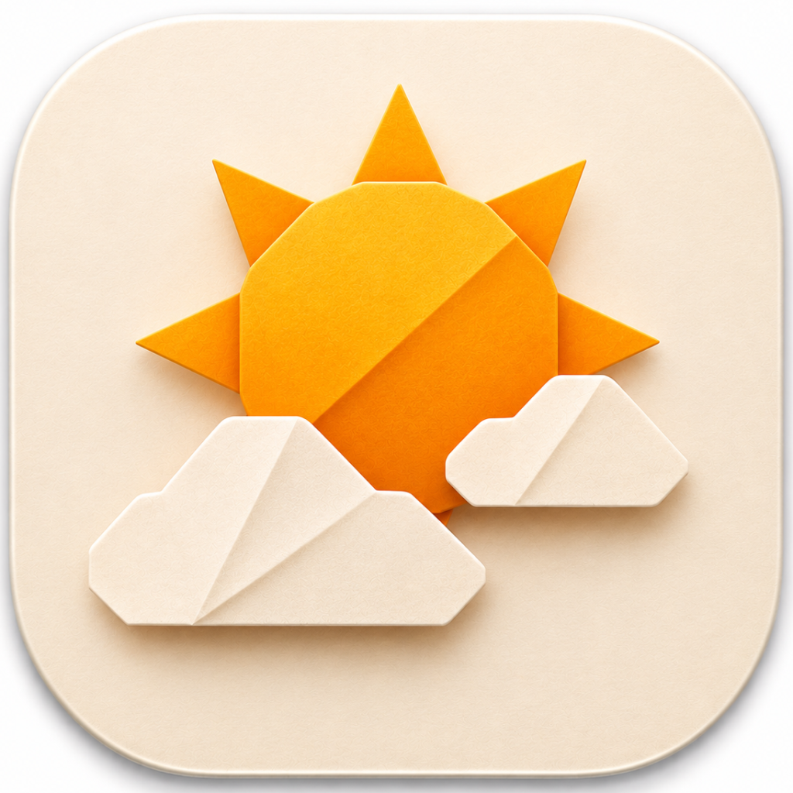

<p align="center">
  
</p>

# Mirlo Weather

App nativa de barra de menús para macOS que muestra el tiempo de **tu estación
Netatmo** o, si no tienes cuenta, de las **estaciones públicas de tu localidad**.
Es de solo lectura: nunca controla la caldera ni envía consignas.

## Descarga

La versión oficial se distribuye **únicamente a través de la App Store**
(macOS 13 o posterior). El enlace se añadirá aquí cuando Apple apruebe la
versión 1.0.

Este repositorio contiene el **código fuente**. No se publican binarios ni
actualizaciones fuera de la App Store.

## Dos compilaciones

El mismo código genera dos variantes. La de App Store se activa con la
condición de compilación `APPSTORE` en `MirloWeather.xcodeproj`.

| | App Store (oficial) | Independiente (desarrollo) |
| --- | --- | --- |
| Bundle ID | `com.paoloac.mirloweather` | `es.privado.netatmo-free` |
| Versión | 1.0 (1) | 0.4.1 (17) |
| macOS mínimo | 13.0 | 12.0 |
| Distribución | App Store | Solo local/interna |
| Actualizador | No | GitHub (solo compilaciones internas) |
| Llavero | Datos protegidos, sin diálogo | Llavero clásico |
| Configuración | Contenedor de la app (sandbox) | `~/.netatmo-free/config.json` |
| Idiomas | Español e inglés | Español e inglés |

La variante independiente se conserva para desarrollo y para Macs con macOS 12.
**No es un canal de distribución**: no se publican `.zip` ni releases con ella.

## Estructura

- `main.swift`, `Avisos.swift`, `SettingsWindow.swift`, `Localidad.swift`,
  `OnboardingWindow.swift`, `BuscarEstacionWindow.swift` y `Localization.swift`:
  código de la app.
- `MirloWeather.xcodeproj`: proyecto de la variante App Store.
- `AppStore/`: `Info.plist`, entitlements, declaración de privacidad, iconos y
  traducciones español/inglés.
- `build.command`: compilación independiente de desarrollo.
- `pruebas.command` y `Tests/`: pruebas mínimas de la lógica de avisos y de las
  claves de localización.
- `ROADMAP.md` y `CHANGELOG.md`: estado, siguientes pasos e historial.
- `docs/`: recursos del repositorio.

## Funciones

- **Dos formas de empezar**: con tu propia estación Netatmo (OAuth) o sin cuenta,
  escribiendo el nombre de tu localidad. La localización se geocodifica con
  `CLGeocoder`; no se usa el GPS ni se pide permiso de ubicación.
- **Varias estaciones y módulos**: estación principal, módulos interiores
  adicionales, exterior, anemómetro y pluviómetro. Cada módulo aparece con su
  nombre y, si procede, aviso de batería baja.
- **Estación cercana**: si tu cuenta no tiene anemómetro o pluviómetro, la app
  busca estaciones públicas de Netatmo y muestra su viento y lluvia como
  `Estación <nombre>`, sin confundirlos con tus lecturas.
- **Modo localidad**: el Worker busca estaciones públicas alrededor del punto
  elegido. La app elige automáticamente la estación más representativa de la
  temperatura (la más cercana a la mediana de la zona) y las más próximas con
  viento o lluvia. Si no hay estaciones en 10 km, amplía a 20 km y abre un
  selector manual; si tampoco hay, avisa para probar otra localidad o conectar
  una estación.
- **Barra de menús** con temperatura exterior/interior, humedad, mín/máx, CO₂,
  ruido, presión, termostato y consigna, viento (con flecha y rachas) o lluvia
  (actual y acumulada en 24 h).
- **Antigüedad del dato**: la línea principal muestra `Último dato hace X min` y
  se marca con ⚠︎ si supera 20 minutos.
- **Avisos configurables**: reglas sobre cualquier sensor, estación cercana,
  caldera oficial y tendencias, con duración mínima, anti-spam, silencios,
  horario de no molestar, resumen diario, aviso de datos obsoletos y registro
  local.
- **Gráfica 24 h**: ventana flotante con el histórico oficial de Netatmo
  (`getmeasure` a 30 min) para temperatura, humedad, CO₂, presión y ruido,
  aunque la app haya estado cerrada. El eje cubre siempre 24 h y los huecos
  reales se dejan en blanco. Para viento, lluvia de una estación cercana y
  caldera, Netatmo no publica histórico: la gráfica usa las muestras de este
  Mac y lo indica en el pie. El selector **Campo** permite cambiar entre todos
  los campos sin cerrar la ventana.
- **Caldera**: estado real publicado por el termostato y tiempos oficiales de
  Netatmo (`sum_boiler_on`) para hoy, ayer y el mes en curso. No se estima por
  muestreo.
- **Menú limpio**: sin opciones técnicas. Manteniendo **⌥ Opción** aparecen las
  herramientas de mantenimiento.
- **Inicio al arrancar** y **Ajustes** con idioma, resaltado por bloques y color
  del texto del resaltado.
- **Sin telemetría**: no hay analíticas, publicidad ni recursos de terceros.

## Compilar

Requiere Xcode y las herramientas de desarrollo de Apple.

### Variante App Store

```sh
open MirloWeather.xcodeproj
```

Selecciona el esquema **Mirlo Weather**, configura tu equipo de firma y archiva
con **Product → Archive**. La app está preparada con sandbox, `PrivacyInfo.xcprivacy`,
localizaciones español/inglés y sin mecanismos de actualización propios.

### Variante independiente

```sh
./build.command
open "Mirlo Weather.app"
```

Compila, firma (Developer ID si hay identidad; si no, ad-hoc) y genera la app en
la carpeta del proyecto. Para macOS 12 y pruebas locales.

### Pruebas

```sh
./pruebas.command
```

Compila el código real de `Avisos.swift` con apoyos de prueba y ejecuta la suite
del histórico local y del motor de avisos. Después comprueba que todas las
claves usadas con `L("…")` existen en español y en inglés. Usa una carpeta
temporal: no toca `~/.netatmo-free`.

## Primera conexión

1. Abre la app. Aparece un icono en la barra de menús y, si aún no hay
   configuración, la ventana de bienvenida.
2. Elige **Tengo mi estación de Netatmo** o **Ver el tiempo de mi localidad**.
3. Con cuenta: pulsa **Conectar con Netatmo**, autoriza el acceso de solo lectura
   en el navegador y vuelve a la app automáticamente.
4. Sin cuenta: escribe la localidad (por ejemplo `Algete, Madrid`) y la app
   busca estaciones públicas cercanas.
5. La ventana de bienvenida se puede cerrar con **Ahora no**; la app sigue en la
   barra y se puede configurar después desde el menú.

## Seguridad y privacidad

- OAuth 2.0 con PKCE (`S256`), `state` de un solo uso y callback
  `netatmofree://oauth/callback`.
- El `code_verifier` y el `state` viven solo en memoria durante la conexión.
- La credencial de instalación va al Llavero de macOS, nunca a un archivo.
- En la variante App Store se usa el llavero de datos protegidos, propio de la
  app: no pide permiso para acceder a elementos de otras apps.
- La app solo hace `GET` de lecturas y de datos públicos; nunca envía consignas
  ni controla la caldera.
- No hay telemetría ni recursos de terceros. La declaración de privacidad está
  en `AppStore/PrivacyInfo.xcprivacy`.

El modo sin cuenta usa el servicio `netatmo-free-worker` (Cloudflare Workers +
D1), operado por el autor. No se envían datos personales: solo las coordenadas
de la localidad elegida y la IP para el límite de peticiones.

El código del Worker no forma parte de este repositorio por ahora: es el
servicio compartido que atiende a la app. Si se publica más adelante, será con
su propia guía de despliegue y sin credenciales.

## Limitaciones conocidas

- La localidad se escribe a mano: no hay detección automática por GPS.
- La estación cercana y el modo localidad dependen de que otras personas
  compartan sus datos en Weathermap. Si una estación desaparece o deja de
  publicar viento/lluvia, la app lo avisa y permite elegir otra.
- La gráfica no puede dibujar el histórico de viento o lluvia de una estación
  pública cercana: Netatmo solo entrega su dato actual (`getpublicdata`). En
  esos campos se muestran las muestras guardadas por la app en este Mac.
- Ningún sitio web puede cerrar una pestaña que el usuario abrió a mano. Tras
  autorizar, la página muestra **Cuenta conectada** e intenta volver a la app.
- Si se pierde la credencial del Llavero pero se conserva la configuración, hay
  que usar **⌥ + menú → Avanzado → Restablecer conexión…** y volver a autorizar.
- La compilación ad-hoc puede hacer que macOS pida permiso al Llavero tras una
  recompilación. La versión de App Store no tiene ese problema.
- Las notificaciones necesitan permiso del sistema. Si se deniegan, los avisos
  siguen apareciendo en el menú y en la barra.

## Contribuciones

Los informes de errores y las propuestas son bienvenidos en
[Issues](https://github.com/paoloacx/mirlo-weather/issues). Para cambios
grandes, abre antes un issue para acordar el enfoque.

## Licencia

[MIT](LICENSE) © 2026 Paolo Álvarez.

La licencia cubre el código. Si reutilizas el proyecto, usa otro nombre y otro
icono para no confundirlo con la app oficial.
